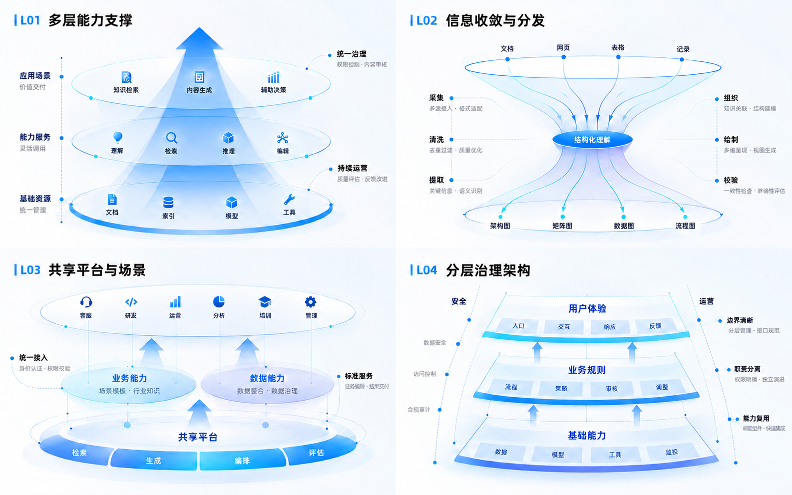

# LogicRender

**Turn article content into structured visuals.**

[Version 1.0](https://github.com/5101good/logic-render/releases/tag/v1.0) · [中文](README.md) · [Skill](skills/logic-render/SKILL.md) · [Examples](examples/requests.md) · [License notes](LICENSE_NOTES.md)

LogicRender is an Agent Skill for explanatory article illustrations. It selects
structures from the content and applies the library's fine linework, gradients,
shadows, typography and color hierarchy. **Borrow the visual language and design
quality; build the composition from the content.** Layout, layer count, module
shapes and connectors can change freely while retaining a refined finish.

The library contains **eight PNG contact sheets and 32 complete compositions**:
two sheets per family, with four panels in a 2×2 grid on each sheet. Indigo and
cobalt anchors, azure/cyan transitions and pale lavender layers give the diagrams
visual depth. A normal request produces one complete figure designed around the
content. A panel ID selects a visual reference; its layout is binding only when
the user explicitly asks to keep or reproduce that layout.



| Family | Sheet 01 | Sheet 02 | Panel guide |
| --- | --- | --- | --- |
| Layered architecture | [L01–L04](skills/logic-render/assets/layered-01.png) | [L05–L08](skills/logic-render/assets/layered-02.png) | [Layered](skills/logic-render/references/layered.md) |
| Tables and matrices | [M01–M04](skills/logic-render/assets/matrix-01.png) | [M05–M08](skills/logic-render/assets/matrix-02.png) | [Matrix](skills/logic-render/references/matrix.md) |
| Data reports | [C01–C04](skills/logic-render/assets/chart-01.png) | [C05–C08](skills/logic-render/assets/chart-02.png) | [Chart](skills/logic-render/references/chart.md) |
| General logic | [G01–G04](skills/logic-render/assets/logic-01.png) | [G05–G08](skills/logic-render/assets/logic-02.png) | [Logic](skills/logic-render/references/logic.md) |

Template content is illustrative. Chart values are synthetic demonstrations;
recalculate all marks, scales and angles from actual input data.

## Install

With Node.js and the [Skills CLI](https://github.com/vercel-labs/skills):

```bash
npx skills add 5101good/logic-render --skill logic-render

# Or choose a global target:
npx skills add 5101good/logic-render --skill logic-render -a codex -g
npx skills add 5101good/logic-render --skill logic-render -a claude-code -g
```

For manual installation, clone the repository and copy the entire
`skills/logic-render` folder, including references, assets and LICENSE, to:

| Client | Global location | Project location |
| --- | --- | --- |
| Codex | `~/.agents/skills/logic-render` | `.agents/skills/logic-render` |
| Claude Code | `~/.claude/skills/logic-render` | `.claude/skills/logic-render` |

Compare existing files before replacing an installation. Start a new session
after installation. See [Codex's documentation](https://developers.openai.com/codex/skills/).

## Use

Invoke `$logic-render` in Codex, `/logic-render` in Claude Code, or mention the
skill explicitly:

```text
Use logic-render to illustrate this technical architecture with English labels.
The knowledge layer processes documents and maintains indexes, supporting
retrieval. Retrieval organizes evidence for the interaction layer to answer
questions. Access control and evaluation span all three layers.
Use L04 as a style reference, retain its depth and fine linework, and design the
layout around these relationships.
```

You can supply an article for illustration planning, request prompts only, or
provide measured values for a precise chart. Default output is one 16:9 figure;
a requested ratio takes priority. The workflow follows the user's language.

## Host capabilities

The skill works with image-generation and code-based drawing agents. Image-model
hosts attach the selected sheet as a style reference and describe the new layout
separately. Code-based hosts derive the layout from the actual nodes and
relationships, then apply the visual treatment with SVG or plotting tools;
complex material effects depend on their rendering capabilities. Quantitative
charts prefer deterministic plotting.

**No image model, API key or hosted service is included.** Without rendering
tools, the skill delivers a complete prompt and exact labels. Downloading the
repository does not install it into ordinary ChatGPT web chat.

## Validation

See [example requests](examples/requests.md) for all four families, missing data
and dense mobile content. Python 3.10+ validates the package without dependencies:

```bash
python scripts/validate.py
python -m unittest discover -s tests -v
```

Checks cover metadata, standalone resources, links, PNG integrity, hashes and
32 panel index entries. Visual quality, labels and chart geometry need inspection.

## License

The skill instructions, documentation, validation code and template library are
distributed under [MIT](LICENSE), to the extent of rights the contributors can
grant. See [license notes](LICENSE_NOTES.md) for user-supplied materials and outputs.
