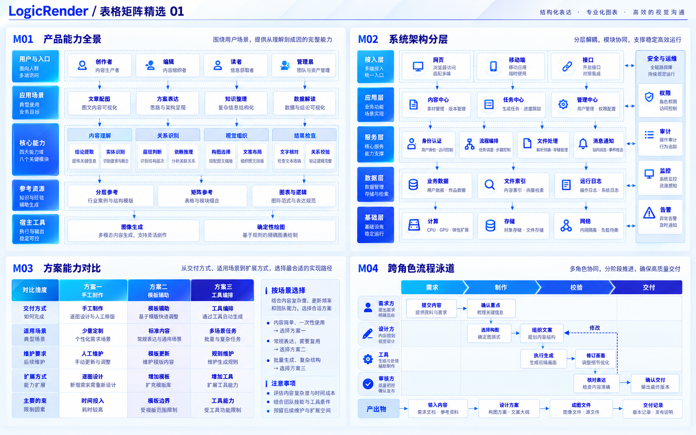

# LogicRender

**从文章内容到结构化图解。**

[1.0 版本](https://github.com/5101good/logic-render/releases/tag/v1.0) · [English](README.en.md) · [Skill](skills/logic-render/SKILL.md) · [使用示例](examples/requests.md) · [许可说明](LICENSE_NOTES.md)

LogicRender 是一个文章配图 Agent Skill。把文章、段落或数据交给 AI，按真实关系选择图型，生成层次清楚、文字可读的配图。内置四类、八张多图模板大图，共 32 个完整构图；每张以 2×2 排列，便于模型一次读取、比较和选型。

模板采用细线、渐变、投影与子模块，用靛蓝、钴蓝、青蓝和淡紫区分结构层次。**参考模板的视觉风格与设计品质，按实际内容重新组织构图。** 布局、层数、模块形状和连接方式均可自由调整，同时保留精细线条、丰富色阶和空间层次。指定模板编号默认只选定视觉参考；明确要求沿用某个布局时，才保留该布局。

| 多层架构 | 表格矩阵 |
| --- | --- |
|  |  |
| 数据图表 | 通用逻辑 |
|  |  |

| 模板类型 | 第一张 | 第二张 | 构图索引 |
| --- | --- | --- | --- |
| 多层架构 | [L01–L04](skills/logic-render/assets/layered-01.png) | [L05–L08](skills/logic-render/assets/layered-02.png) | [结构与适用场景](skills/logic-render/references/layered.md) |
| 表格矩阵 | [M01–M04](skills/logic-render/assets/matrix-01.png) | [M05–M08](skills/logic-render/assets/matrix-02.png) | [结构与适用场景](skills/logic-render/references/matrix.md) |
| 数据图表 | [C01–C04](skills/logic-render/assets/chart-01.png) | [C05–C08](skills/logic-render/assets/chart-02.png) | [结构与适用场景](skills/logic-render/references/chart.md) |
| 通用逻辑 | [G01–G04](skills/logic-render/assets/logic-01.png) | [G05–G08](skills/logic-render/assets/logic-02.png) | [结构与适用场景](skills/logic-render/references/logic.md) |

模板中的文案用于说明结构，图表使用示意数据。真实数据图表需要从输入数值重新计算比例、刻度和角度，不能照搬模板中的几何形状。

## 安装

需要 Node.js。使用 [Skills CLI](https://github.com/vercel-labs/skills) 选择客户端：

```bash
npx skills add 5101good/logic-render --skill logic-render

# 指定全局安装位置
npx skills add 5101good/logic-render --skill logic-render -a codex -g
npx skills add 5101good/logic-render --skill logic-render -a claude-code -g
```

手动安装时，克隆仓库，将整个 `skills/logic-render` 文件夹复制到对应位置，包含 `references`、`assets` 与 `LICENSE`：

| 客户端 | 全局安装 | 项目级安装 |
| --- | --- | --- |
| Codex | `~/.agents/skills/logic-render` | `.agents/skills/logic-render` |
| Claude Code | `~/.claude/skills/logic-render` | `.claude/skills/logic-render` |

如已安装，请先比较版本，保留自定义修改。安装后新开会话，让客户端发现 skill。参见 [Codex 官方文档](https://developers.openai.com/codex/skills/)。

## 使用

Codex 可调用 `$logic-render`；Claude Code 可调用 `/logic-render`。也可以直接写“使用 logic-render”。

```text
使用 logic-render，为下面的技术方案生成一张中文配图：
知识助手分为知识层、检索层和交互层。
知识层负责文档处理与索引维护，支撑检索层；检索层整理证据，支撑交互层生成回答。
权限与评估贯穿三层。参考 L04 的视觉风格，保留色阶、细线和空间层次，按上述关系设计布局。
```

```text
使用 logic-render 为这篇文章规划配图位置并生成配图。
面向公众号手机阅读；信息过密时拆成总览与细节图。
[粘贴文章正文]
```

```text
使用 logic-render，为这段方案对比写完整生图提示词。只要提示词。
[粘贴对比内容]
```

默认输出一张根据内容设计的完整图，比例为 16:9，也可指定比例。仅在要求模板合集时输出多图大图。更多场景见[请求示例](examples/requests.md)。

## 工具适配

| 宿主能力 | 使用方式 |
| --- | --- |
| 有图像模型的 Agent | 附上模板作为风格参考，单独描述按内容设计的布局，再调用宿主生图工具 |
| 使用代码绘图的 Agent | 按真实节点与关系设计布局，用 SVG 或绘图库实现模板的配色、细线、渐变与阴影；复杂材质效果取决于工具 |
| 精确数据图表 | 优先确定性绘图，校验数值、比例、单位与刻度 |
| 无绘图工具 | 交付完整提示词与准确文案 |

Skill **不附带图片模型、API Key 或图像生成服务**。Codex、Claude Code 均可使用，实际成图能力取决于宿主配置。普通 ChatGPT 网页对话不会因为下载仓库就自动安装此 skill。

## 许可

技能指令、文档、校验代码与模板库按 [MIT](LICENSE) 发布，许可范围限于贡献者有权授予的内容。用户提供的素材与生成结果的使用边界见[许可说明](LICENSE_NOTES.md)。

## 维护

使用 skill 不需要 Python。维护者可用 Python 3.10+ 检查安装包：

```bash
python scripts/validate.py
python -m unittest discover -s tests -v
```

验证覆盖技能元数据、独立安装所需文件、文档链接、八张 PNG 的完整性与哈希、32 个构图的索引。替换资产后同步更新清单；视觉质量、文字和图表几何仍需查看成图。
